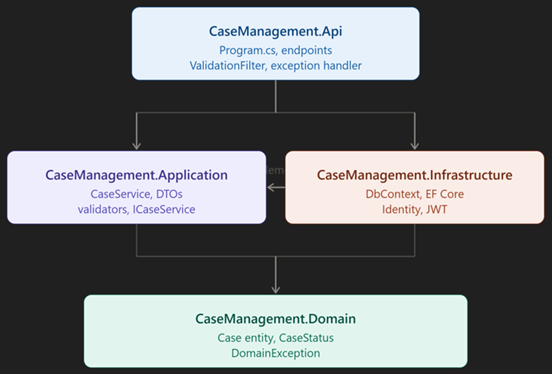

# Case Management API

A sample Case Management API built using ASP.NET Core and Clean Architecture principles.

## Overview

This project demonstrates how to build a scalable, maintainable, and testable Web API using modern .NET development practices.

## Features

- Clean Architecture
- ASP.NET Core Web API
- Entity Framework Core with PostgreSQL
- JWT Authentication with refresh token rotation
- Role-based Authorization
- Docker & Docker Compose
- Dependency Injection
- Global Exception Handling
- RESTful APIs
- Swagger / OpenAPI
- Unit Testing
- Case notes: one-to-many notes per case (`POST/GET /cases/{id}/notes`)

## Project Structure

```
CaseManagement
│
├── src
│   ├── CaseManagement.Api
│   ├── CaseManagement.Application
│   ├── CaseManagement.Domain
│   ├── CaseManagement.Infrastructure
│   └── ...
│
├── tests
│   └── CaseManagement.Api.Tests
│   └── CaseManagement.Domain.Tests
|        
└── CaseManagement.sln
```

## Prerequisites

- .NET SDK 10.0 or later
- Docker Desktop (for containerized run)
- Visual Studio 2022/2026

## Getting Started

### Run with Docker (recommended)
```bash
docker compose up --build
```
API: http://localhost:8080 · Interactive docs: http://localhost:8080/scalar/v1

### Run with .NET Aspire
Set `CaseManagement.AppHost` as the startup project (Docker must be running).

## Demo credentials (Development only)
On first start in the Development environment, the app creates a default admin:

| Email | Password |
|-------|----------|
| admin@casemanagement.local | Admin123! |

These are **demo credentials for local use only**. They are created only when `ASPNETCORE_ENVIRONMENT=Development`. Change the JWT key and remove the seeded admin before any real deployment.

## Technologies Used

- ASP.NET Core, Entity Framework Core, PostgreSQL, .NET Aspire
- JWT Authentication + Refresh Tokens
- Docker, OpenAPI + Scalar, xUnit

## Future Enhancements

- Azure Deployment
- Logging with Serilog
- Caching

## Architecture


## Try the API
- OpenAPI spec: [`docs/openapi.json`](docs/openapi.json)
- Postman: import `docs/CaseManagement.postman_collection.json`, run **Login** first (it stores the JWT automatically), then call any case endpoint.
- Interactive docs: run the API in Development and open `/scalar/v1`.

## License

This project is intended for learning and demonstration purposes.
